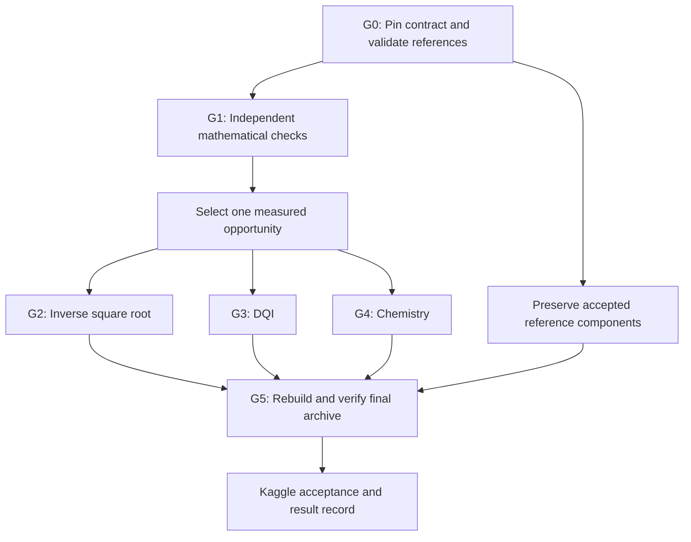

# Google Verifiable Quantum Circuit Compilation — Detailed Implementation Plan

**Prepared:** 26 October 2026  
**Status:** implementation specification; execution has not started  
**Source:** `deep-research-report-corrected.md`, corrected edition dated 26 October 2026  
**Source SHA-256:** `bd39391052932a4a1eb8c2add12e1ab2d67ab7afbc5a41983f613a8b34273bcd`

## 1. Goal, scope, and evidence boundary

Build a reproducible toolchain that produces a valid competition ZIP and improves at least one benchmark's official resource cost while preserving validity of all three components. The preferred first experiment is inverse square root because its numerical input domain can be checked exhaustively. This preference is provisional until baseline profiling establishes feasibility and cost.

The source report supplies the research basis. This plan adds implementation tasks, interfaces, test tiers, decision rules, and release evidence. It does not certify the report's external sources, current competition availability, baseline acceptance, package compatibility, or any performance improvement. No official evaluator, circuit, or optimization has been executed while preparing this plan. All competition constants below are **report-derived requirements pending G0 reconciliation**.

The official metric notebook, starter kit, exact schemas, and reference archive must be acquired and run in G0. A conflict between the paper, rules, and package becomes a recorded blocker for the affected work; do not silently choose whichever version is easiest to implement.

### 1.1 Two delivery scopes

| Scope | Included work | Completion condition | Planning effort |
|---|---|---|---:|
| First improved release | G0, conservatively budgeted full G1, one optimization workstream, G5 | All components accepted; at least one lower official cost; aggregate score above reference | **27–41 person-days** through inverse square root |
| Full research program | G0–G5, including all three optimization workstreams | Each workstream has documented results; release uses the best validated component available for each task | **79–126 person-days** |

These are engineering estimates inherited from the report, not elapsed-time commitments or guarantees of improvement. They assume competence in reversible circuits and numerical methods and exclude potentially substantial chemistry optimizer compute. A failed research hypothesis can close an experiment without producing a replacement circuit. It does not satisfy that workstream's improvement gate.

Do not start all three optimization programs to obtain the first release. If an unchanged component's reference is invalid, it cannot be used as a fallback; resolve that baseline blocker before assembling a complete submission.

### 1.2 Non-goals for the first release

- No custom general-purpose quantum compiler or generic state-vector simulator.
- No automatic translation of Gu et al.'s released circuits into Kaggle-compatible solutions.
- No mandatory new DQI decoder or chemistry factorization if those references pass.
- No exhaustive enumeration of measurement branches for a whole large circuit.
- No claim that a local randomized test reproduces Kaggle's private challenge stream.

## 2. Dependency structure and completion gates



Only one optimization branch is required before G5. Every submitted component still needs full release verification.

| Gate | Required evidence | Failure response |
|---|---|---|
| G0 | Immutable source/toolchain snapshot; resolved contract; unmodified reference accepted locally with documented score normalization near 1.0 | Diagnose versions, schema, or baseline; block affected optimization |
| G1 | Independent mathematical checks agree with pinned evaluator; adversarial and boundary tests pass | Reduce discrepancy to a fixture; resolve convention before synthesis |
| G2 | Exhaustive numerical feasibility; zero full-verifier failures; lower official inverse-square-root cost | Retain reference; close or revise hypothesis |
| G3 | Correct exact BM implementation; any chosen approximation has measured penalty and lower full cost | Keep exact control/reference; isolate field, algorithm, or approximation error |
| G4 | Quantized-output reconstruction passes every constraint; each angle circuit within limit; lower full chemistry cost | Retain validated factorization/reference; revise precision or representation |
| G5-local | Two reproducible builds; extracted ZIP passes all full local checks; evidence matches artifact hashes | No submission-ready status; fix or roll back |
| G5-remote | Exact ZIP accepted by Kaggle, with result identifier and score retained | Investigate discrepancy; do not label local pass as remote acceptance |

## 3. Contract to implement

Every value in this section must have a provenance entry in `contracts/contract.json`: report location, official source path and symbol or notebook cell, version/hash, extracted value, and reconciliation status. Unknown names or array shapes stay explicitly unresolved; do not guess them from notation.

### 3.1 Inverse square root

| Property | Report-derived requirement |
|---|---|
| Input | Exactly one named quantum register `x`, 22 bits |
| Valid domain | Integers `1..3_133_452`, inclusive |
| Transformation | Preserve `x`; apply phase `exp(2πi / sqrt(x))`; restore all scratch to zero |
| Phase comparison | Turns modulo one; verifier-specific 64-bit fixed-point ideal computed using integer square-root arithmetic |
| Tolerance | Circular phase error at most `2^-24 / sqrt(x)` turns |
| Release trajectories | 64 per valid input; **200,540,928** total |
| Failure budget | Zero |
| Objective | Official `Q × C`, including the fine-rotation synthesis charge |
| Reported baseline | `Q=260`, 7,735 Toffolis, one T gate, 37 non-Clifford rotations, `C=7,988` |

The schematic arithmetic expression `C = N_Toffoli + N_T/4` is insufficient unless `N_T` includes the official treatment of synthesized rotations. Implement the exact evaluator pricing and rounding rules rather than deriving cost from raw instruction counts alone. The reported product `260 × 7,988 = 2,076,880` is a reconciliation target, not a substitute measurement.

The input `x=1` has phase one turn, equivalent to zero. Tests must catch linear rather than circular phase subtraction. The circuit's rotation encoding and the verifier's phase accumulator use different precisions; pin both.

### 3.2 DQI / Reed–Solomon

| Property | Report-derived requirement |
|---|---|
| Parameters | `(m,n,b,r)=(4095,70,12,2016)`; unique decoding radius 35 |
| Field modulus | `z^12 + z^6 + z^4 + z + 1` |
| Encoding | Little-endian polynomial basis `(1, α, …, α^11)` |
| Syndrome | 70 field elements, 840 quantum bits; `s_i = Σ_j e_j α^((i+1)j)` |
| Classical record | Fresh per-instance `c`, 49,140 bits; exact binding mechanism to be pinned |
| Required phase | `(-1)^(c · bin(e(s)))`, syndrome preserved, scratch clean |
| Official sample count | `N=102,400` |
| Failure bound | One-sided Clopper–Pearson upper bound with tail probability `δ=2^-128` |
| Objective | `R(ε⁺) Q² T`, with the evaluator's definition of `T` |
| Rejection threshold | `ε⁺ >= 1/16` has no finite score |
| Reported baseline | 1,893 qubits; **5,725,461 Toffolis** |

Here `R(ε)=ln(2)/[-ln(1/2+2 sqrt(ε))]`. For zero failures, `ε⁺=1-2^(-128/N)`, approximately `0.0008660587302`, and `R≈1.191260465`. Zero observed failures does not remove the repetition penalty.

The official distribution samples error weight from the specified eigenvector distribution, then distinct positions and nonzero field symbols, and an independent random mask. Import and validate the exact sampler or its defining data in G0; do not replace it with uniform weights. Uniform coverage of weights 0–35 belongs in correctness testing, separately from score estimation.

### 3.3 Chemistry

| Property | Report-derived requirement |
|---|---|
| Instance | FeMo-co; 76 orbitals, 113 electrons |
| NPZ arrays | `U`, `W`, `H2_I`, `H1_I`, `Hsym_lower`, `tree_edges`; shapes/dtypes/conventions pinned in G0 |
| Frozen symmetry | `S=S0`, `β1=β1,0`; supplied values are not search parameters |
| Selection addresses | First `N` one-body vectors, then `RB` two-body vectors; width `ceil(log2(N+RB))` |
| Angle words | β-bit fixed-point representation of `[0,2)`; exact angular-unit conversion pinned in G0 |
| Batching | `J` angles per batch; `K=ceil((N-1)/J)` circuits |
| Forward operations | First batch load, then XOR differences between successive batches |
| Reverse operations | Undo sequence and return angle storage to zero |
| Width limit | At most **128 qubits per angle circuit** |
| Release testing | 64 measurement samples per valid vector address under the official forward/reverse protocol |
| Residuals | Both coefficient Frobenius residuals at most `0.020 Ha` after reconstruction from emitted angle words |
| Energy reference | Core-inclusive `E_upper = -22140.27335 Ha` |
| Strict conditions | Finite metrics; `Λ>49.0`; `E_gap>3.914898`; `0<E_gap<2Λ` |
| Objective | `λ_eff T_tot Q_tot`, where `λ_eff=sqrt(E_gap(2Λ-E_gap))` |

The two-electron residual is

\[
\epsilon_2=\left\|\widetilde h^{(2)}-h^{(2)}-\frac{S_0\otimes I+I\otimes S_0}{2}\right\|_F.
\]

The one-electron residual compares the reconstructed transformed one-electron tensor with the official transformed target. Pin its dependence on candidate factors and its eigenvector matching convention; avoid inventing an independent sign/order convention that disagrees with the evaluator.

Compute `E_gap = E_upper - E_SOS` with consistent energy conventions. Do not clamp an invalid gap or normalization value into the feasible region. `Q_tot` is the complete modeled qubit cost and is **not capped at 128**. It includes persistent registers and the maximum of shared sequential temporary-workspace requirements. `T_tot` includes both oracle traversals, Outer/Inner state preparation, and Givens costs.

These residuals are coefficient-space constraints, not guarantees of a 20 mHa many-electron energy error.

### 3.4 Archive contract

Use canonical binary circuits for releases. Required paths are:

| ZIP path | Source |
|---|---|
| `invsqrt.kmb` | Selected generated circuit or validated reference |
| `dqi.kmb` | Selected generated circuit or validated reference |
| `dfthcsos/angle_k_0.kmb` through `angle_k_<K-1>.kmb` | Contiguous zero-based angle circuits |
| `dfthcsos/submission.npz` | Matching factorization and tree |

The report also permits `.kmx`; G0 must verify the live rules. Avoid including both encodings of the same circuit. No extra enclosing directory. Keep certificates, logs, and manifests beside the ZIP unless the pinned rules explicitly allow them inside. The baseline reportedly contains ten angle circuits; a new candidate's `K` follows its validated `J` and contract, not that baseline count.

## 4. Minimal implementation architecture

Use one Python project with the official kickmix execution backend and an ordinary command-line interface. Python handles orchestration, references, search, and reports. Profile first; move a numerical kernel to a compiled/vectorized path only when measurements justify it. Do not build a second full kickmix simulator.

| Proposed path | Responsibility |
|---|---|
| `contracts/` | Resolved constants, schema, source manifest, discrepancy register |
| `vendor/README.md` | Acquisition instructions, immutable versions, licenses; no unlicensed redistribution |
| `src/qcompile/official.py` | Narrow adapter to the pinned official loaders, evaluator, and scorer |
| `src/qcompile/reference/` | Independent numerical and algebraic implementations |
| `src/qcompile/invsqrt/` | Fixed-point model, approximation search, circuit generator |
| `src/qcompile/dqi/` | Generated field constants, exact BM, phase extraction, explicit approximations |
| `src/qcompile/chemistry/` | Factorization, tree/quantization, batching, QROM generation |
| `src/qcompile/artifacts.py` | Serialization, hashes, deterministic NPZ/ZIP, extraction preflight |
| `src/qcompile/experiments.py` | Candidate records, budgets, promotion decisions |
| `tests/` | Unit, differential, mutation, integration, and release tiers |
| `configs/` | Immutable experiment configurations and release selections |
| `runs/<run_id>/` | Logs, metrics, profiles, fixtures, and artifacts tied to a run |
| `releases/<release_id>/` | ZIP, hash manifest, certificate, and remote result |

Keep reference implementations independent of generator arithmetic. They may share frozen contract data and serialization readers, but must not share the numerical kernel they are intended to validate. Production adapters wrap the official implementation; independent checks cross-validate it rather than silently replacing it.

### 4.1 Proposed interfaces

The following interfaces and CLI are design targets, not existing official APIs:

```python
load_contract(path) -> Contract
validate_static(artifact, contract) -> StaticReport
build_candidate(config, contract, output_dir) -> ArtifactSet
verify_candidate(artifacts, contract, tier, seed_policy) -> VerificationReport
score_candidate(artifacts, verification, contract) -> ScoreReport
package_release(selection, contract, output_dir) -> ReleaseRecord
```

`ArtifactSet` identifies each file as `generated` or `retained_reference`, its hash, provenance, and relevant benchmark. `VerificationReport` records test scope, completed versus expected cases, failures, seed provenance, and the exact evaluated hashes. `ScoreReport` separates estimated cost from official measured cost and rejects missing or non-finite inputs. Failed validation cannot produce a release-eligible score.

### 4.2 Experiment identity and status

Record source revision, dirty-tree status, contract hash, dependency lock hash, generator configuration, all artifact hashes, seeds, hardware, thread settings, elapsed time, peak memory, and raw evaluator logs. Dirty-tree experiments are allowed during development but cannot become releases without a frozen source revision.

Use explicit states: `draft`, `numerically_feasible`, `circuit_smoke_passed`, `full_local_passed`, `release_selected`, `remote_accepted`, and `rejected`. A candidate cannot skip required states. A configuration without serialized artifacts cannot claim full verification. A changed artifact hash invalidates verification evidence for those bytes; a changed contract invalidates affected prior comparisons.

Start with JSON records and a CSV comparison index. Add a database only if volume makes the file-based approach inadequate.

## 5. G0 — Freeze the contract and establish executable baselines

**Budget: 3–5 person-days. Dependencies: access to official assets.**

| Task | Implementation work | Deliverable / acceptance |
|---|---|---|
| G0.1 Acquire assets | Download rules, Data/Evaluation pages, full metric notebook, starter kit, reference ZIP, paper v2, relevant source revisions | `sources.lock.json` with filenames, origin, version, acquisition date, SHA-256, and redistribution status |
| G0.2 Pin environment | Select supported Python/toolchain from the actual packages; lock numerical libraries and kickmix revision; capture compiler/OS | Fresh installation loads all reference artifacts and runs a tiny circuit |
| G0.3 Extract executable contract | Inspect registers, gate set, schemas, endian rules, phase units, accounting, sampling, and rejection conditions | `contract.json`, schema validators, per-field provenance; zero unresolved release-critical fields |
| G0.4 Run unmodified references | Evaluate the original ZIP without converting or regenerating it first; preserve raw diagnostics | Per-task validity and cost; expected score normalization reconciled with 1.0 |
| G0.5 Resolve chemistry ambiguity | Compare observed acceptance with the paper's contradictory baseline statements | Written resolution or precise upstream issue; no assumption that a new factorization is required |
| G0.6 Profile execution | Measure parse/build/runtime/RAM on smoke and representative workloads; complete baseline evaluation | Resource budget and a measured full-run feasibility decision |
| G0.7 Preserve fallback | Store immutable original ZIP and component hashes; document retrieval | Retained components demonstrably match the accepted local reference bytes |

Normalize score using the official reference quantities; do not force a failed or discrepant run to 1.0 by redefining the baseline. Any allowed numerical tolerance must come from pinned evaluator behavior or explicit documented analysis.

The discrepancy register must at least cover chemistry baseline validity, full chemistry cost, residual conventions, array shapes/dtypes, angle units, DQI classical-record interface, fine-rotation pricing, serialization/hash semantics, and actual runtime/submission limits. Also record whether submissions are currently open; the research timestamp is not evidence of current availability.

**G0 exit:** all release-critical contract questions resolved, full unmodified local reference accepted, baseline costs archived, toolchain install reproducible. If official metric assets are unavailable, mathematical scaffolding may proceed, but G0 remains blocked and all compatibility claims remain provisional.

## 6. G1 — Independent reference and validation layer

**Budget: 8–12 person-days: inverse square root 2; DQI 3–4; chemistry 3–5; integration contingency 0–1.**

### 6.1 Inverse-square-root reference

1. Reproduce the exact integer-derived ideal phase and circular comparison, including the verifier's quantization and rounding.
2. Add a high-precision independent sanity check on selected inputs. Ordinary floating-point `1/sqrt(x)` alone is not the acceptance oracle.
3. Define a candidate fixed-point evaluator with explicit intermediate widths, signedness, rounding, overflow, and truncation at every operation.
4. Implement a chunked full-domain scan that reports the minimum margin, maximum error, worst inputs, and a histogram of margins.
5. Freeze fixtures for endpoints, powers of two and neighbors, normalization transitions, interval boundaries, rounding ties, and worst discovered cases.

**Acceptance:** exact target-phase agreement with the official implementation on boundary and randomized fixtures; intentionally perturbed phase and overflow cases are rejected; full-domain enumeration has no omissions or duplicate-only coverage.

### 6.2 DQI reference

1. Implement transparent carryless polynomial multiplication and reduction for the Kaggle modulus.
2. Implement a separate optimized classical field backend and generate fixed multiplication/squaring maps from the modulus.
3. Implement the official syndrome convention and a classical EEA decoder as a control.
4. Add exact classical BM with root finding and error recovery, independent enough to detect EEA/convention discrepancies.
5. Generate deterministic errors across every weight 0–35 and verify syndrome, decoded error, and parity under multiple masks.
6. Reproduce the official score statistic using numerically stable tail calculations and a high-precision cross-check.

**Acceptance:** exhaustive unary field tests over all 4,096 values where defined; all 4,095 nonzero inverses correct; fixed maps agree on all inputs; randomized multiplication and decoding agree across independent implementations. Include zero syndrome, single errors at positions 0 and 4094, all supported weights, and multiple masks for the same syndrome. Division by zero has an explicit tested contract.

### 6.3 Chemistry reference

1. Read and validate all official arrays using actual schema conventions and finite-value checks.
2. Validate a rooted, ordered spanning tree: valid vertices, no cycles, correct edge count, connectivity, root and parent-before-child rules.
3. Decode actual oracle words and reconstruct vectors by the ordered Givens operations.
4. Rebuild candidate tensors using fixed symmetry values and official one-electron matching.
5. Independently calculate residuals, `Λ`, `E_SOS`, gap, and `λ_eff`.
6. Reconcile all modeled `T_tot` and `Q_tot` terms against the official scorer, exposing a component-by-component breakdown.

**Acceptance:** reference residuals and cost terms agree within explicitly justified numerical tolerances; changing tree order, word precision, symmetry data, or energy convention is detected. Large tensor computations are blocked/chunked if needed; a small-instance dense calculation validates the memory-saving implementation.

### 6.4 Scope reduction for the first release

The 27–41 person-day estimate includes full G1. A narrower first implementation can concentrate independent development on the selected benchmark while retaining full official validation of untouched components. Document the omitted independent checks and re-estimate effort before adopting that scope; do not present a reduced schedule as already established. Never weaken release validation to save G1 effort.

## 7. G2 — Inverse-square-root optimization

**Budget: 10–16 person-days. Start after G0 and the relevant G1 checks pass.**

| Task | Budget | Work and concrete output |
|---|---:|---|
| G2.1 Reference decomposition | 2–3 pd | Separate normalization, lookup, polynomial, Newton, scaling, phase, and cleanup costs; reproduce reported counts or explain differences |
| G2.2 Exhaustive candidate harness | 1–2 pd | Connect each candidate's exact finite-width arithmetic to G1's full-domain oracle; emit feasibility and margin records |
| G2.3 Approximation search | 3–5 pd | Compare baseline cubic+Newton, fewer-coefficient polynomial, normalized affine, and table/affine correction families |
| G2.4 Phase/resource optimization | 2–3 pd | Compare temporary accumulator versus direct phase; price fine rotations; test reversible versus measurement-based lookup cleanup |
| G2.5 Circuit integration | 2–3 pd | Generate kickmix, validate register/ancilla behavior, run full local verification, and select a cost improvement |

### 7.1 Search protocol

For each family, define normalization, index bits, local-coordinate bits, coefficient widths, intermediate widths, rounding, zero or one Newton step, lookup scheme, and phase construction. Fit coefficients against actual finite-input and fixed-point semantics. A real-valued fit is only a starting point.

Use this promotion order:

1. Boundary checks and a representative numerical sample.
2. Exhaustive scan over all 3,133,452 inputs.
3. Static resource estimate with all assumptions recorded.
4. Circuit generation and primitive/sampled trajectory checks.
5. Official resource accounting, including rotation charges.
6. Full official-strength local verification on the frozen artifact.

Define numerical margin `m(x)=2^-24/sqrt(x)-abs(circular_phase_error(x))`. Require strictly positive minimum numerical margin as an internal engineering gate, even though the reported official inequality permits equality. This margin does not replace the official rotation synthesis calculation or complete trajectory checks.

### 7.2 Feasibility experiment for affine approximation

The report's simple 128-interval affine proposal already has a continuous-domain diagnostic error much larger than the requested tolerance. Do not budget its published related-task gain as a likely Kaggle gain. Test the actual normalized discrete domain and fixed-point calculation first. If it fails, record the failure boundary and move to more intervals, nonuniform intervals, higher degree, or a correction step within the search budget.

Use an initial **1–2 person-day feasibility timebox within G2.3**, not an additional budget. Stop that family when it lacks a plausible accuracy/cost tradeoff; do not synthesize an invalid approximation merely because its arithmetic is cheap.

### 7.3 Circuit requirements

- Preserve `x` exactly and clean every workspace wire on all tested trajectories.
- Treat overflow and truncation as explicit arithmetic behavior, not implementation accidents.
- Account for normalization and scale restoration, including odd/even exponent transitions.
- Verify branch-dependent phase corrections for measurement-based cleanup.
- Test the deserialized canonical artifact, not only the in-memory builder graph.
- Record `Q`, Toffoli/T counts, rotation inventory, official `C`, `QC`, margin, runtime, and hashes.

**G2 exit:** lower official `QC` than the accepted reference under the same metric, all inputs numerically feasible, and zero failures across 200,540,928 required local trajectories. A cheaper estimate or a passing numerical model alone does not pass G2.

If no candidate improves, retain the reference and close G2 with measured results. Reassess DQI or chemistry based on actual opportunity and remaining budget; do not silently extend the entire research program.

## 8. G3 — Kaggle-compatible Berlekamp–Massey DQI

**Budget: 22–35 person-days. Optional for the first release.**

| Task | Budget | Work and acceptance |
|---|---:|---|
| G3.1 Reversible field arithmetic | 3–5 pd | Generate multiplication/squaring/fixed maps for the Kaggle modulus; compare circuit results with independent polynomial arithmetic |
| G3.2 Exact classical BM | 2–3 pd | Differential tests against EEA, including discrepancy-zero updates and weight 35; reuse G1 fixtures, extend for circuit scheduling |
| G3.3 Reversible locator | 6–9 pd | Implement full exact recurrence; retain or recompute history explicitly; restore inputs/workspace |
| G3.4 Variable-mask phase recovery | 4–7 pd | Chien/root and magnitude processing under exact conventions; accumulate required parity using the supplied `c` |
| G3.5 Workspace and cleanup | 3–5 pd | Recompute versus store, liveness analysis, reciprocal/derivative opportunities, corrected measurement uncomputation |
| G3.6 Explicit approximations | 2–4 pd | Isolated cutoffs/history reductions with known divergence predicates and exact controls |
| G3.7 Full score runs | 2 pd | Freeze finalists; run official-strength 102,400-shot validation; compare complete penalized cost |

### 8.1 Adaptation rules

Regenerate all constants, evaluation tables, squaring maps, Chien increments, and Forney conventions from Google's field representation. Changing one polynomial literal in Gu's implementation is insufficient. Record any borrowed architectural idea and its source revision/license; no fixed-mask tables survive into the variable-mask implementation.

Expose `c` through the official classical-record interface established in G0. Do not allocate 49,140 quantum wires merely because the record has that many bits, and do not infer the classical binding API from the report alone.

The full exact decoder is the control. First implement a straightforward correct parity path; then examine reciprocal-polynomial/direct-phase methods. Do not materialize a full decoded quantum error vector unless profiling establishes a need. Classical test references may reconstruct the full error to validate the parity circuit.

### 8.2 Required test dimensions

For every tested error, vary both the error and mask. Include zero and all-one masks, selected single-bit masks, and independent random masks. Test several masks for the same syndrome to detect accidental fixed-mask specialization. Add `p(c1 XOR c2)=p(c1) XOR p(c2)` as a metamorphic check of parity behavior.

Exercise weights 0–35 independently of their score distribution. Include maximum weight, endpoint positions, multiple field symbols, locator degree transitions, zero discrepancies, and controlled division-by-zero paths. Test exact implementations on the supported domain; behavior outside that domain is not a substitute for the official contract.

Every circuit test checks phase, preserved syndrome, and clean workspace. A decoder that returns the correct classical error but leaves garbage is not a valid circuit.

### 8.3 Stable statistical scoring

Let `δ=2^-128`. For `k<N`, solve

\[
\Pr_{p=\epsilon^+}[\operatorname{Binomial}(N,p)\le k]=\delta.
\]

Use a stable lower-tail/log-CDF or equivalent incomplete-beta formulation with a bracketed solve and an independent high-precision check. Computing `1-δ` in ordinary double precision can round to 1; avoid a naive upper-quantile call that silently returns the wrong bound. For `k=0`, use the stable closed form `-expm1(log(δ)/N)`; for `k=N`, set the upper bound to 1 and reject as non-finite-cost.

Test monotonicity in `k`, the zero-failure reference values, moderate failure counts, and cases on both sides of the `1/16` cutoff. Match the official implementation's rounding/tolerance behavior before promotion. Do not replace `ε⁺` with `k/N`.

### 8.4 Approximation selection and bias control

Keep `exact` and each explicitly named approximation as separate configurations. For each pruning rule, log where it diverges from the exact algorithm and whether the divergence changes phase or cleanup. Unknown failures in the supposedly exact circuit are bugs, not an approximation budget.

Use paired development inputs to compare candidates, and freeze finalists before evaluating on separate precommitted local validation seeds. Store all tried candidates, including failures. An official-style bound for one frozen candidate is not a simultaneous guarantee covering an adaptive search over many candidates. Local validation also cannot predict the hidden salted challenges exactly.

Do not vary semantically irrelevant circuit bytes to seek a favorable challenge stream. Repeated validation seeds estimate stability; they are not a way to cherry-pick the smallest `k`. Reserve any additional robustness runs inside the measured compute budget, and distinguish pooled diagnostic counts from the official `N=102,400` statistic.

**G3 exit:** the exact branch has zero observed failures in full local verification and independent checks; a replacement must improve `R(ε⁺)Q²T` over the official reference. An approximate replacement additionally needs explicit approximation provenance, finite penalized cost, and convincing performance on frozen validation. Zero observed failures is evidence, not a proof of correctness on every possible syndrome and measurement branch.

## 9. G4 — Chemistry factorization and angle-oracle co-design

**Budget: 30–50 person-days, excluding optimizer compute. Optional for the first release.**

| Task | Budget | Work and acceptance |
|---|---:|---|
| G4.1 Numerical reproduction | 4–6 pd | Extend G1 into full candidate scoring; reconcile every baseline cost term and numerical convention |
| G4.2 Factorization search | 7–12 pd | Refine valid starting points; search allowed factor parameters/ranks with fixed symmetry; checkpoint continuous candidates |
| G4.3 Quantized angle generation | 4–6 pd | Extract and encode angles, reconstruct represented vectors immediately, preserve precision provenance |
| G4.4 Tree search | 3–5 pd | Compare allowed line, balanced, and data-driven ordered trees; regenerate angles and costs for each |
| G4.5 Batch and precision search | 3–5 pd | Explore `β,J` near feasible boundaries; account for partial final batches and every workspace wire |
| G4.6 QROM compiler | 6–10 pd | Compare straightforward unary lookup with repeated words/subtrees, deltas, and feasible banked/SelectSwap variants |
| G4.7 Integrated validation | 3–6 pd | Verify actual circuits, reconstruct tensors, compute full cost, and establish regression evidence |

### 9.1 Low-risk entry before a new factorization

If the supplied factorization passes, first hold its represented angle table and tree fixed and optimize lookup implementation. This isolates circuit savings from numerical factorization changes. A byte-different circuit still requires fresh verification, but equivalent output words should reproduce the same numerical tensors.

Do not assume the baseline is invalid because one passage in the paper warns about accuracy. Conversely, do not assume it passes because another passage says so. G0's measured result controls the starting point.

### 9.2 Outer and inner search loops

The outer loop proposes `(R,B,C,Θ)` using only permitted variables. The inner loop chooses `(tree,β,J,QROM architecture)` and evaluates the actual represented problem:

1. Extract angle data for the chosen ordered tree.
2. Quantize using the pinned representation and angular units.
3. Build batch loads and XOR deltas, including final-batch padding rules.
4. Generate angle circuits; obtain their output words for valid addresses.
5. Decode those words and reconstruct all one- and two-body vectors.
6. Form the transformed tensors; compute both shifted/convention-correct residuals.
7. Apply all strict numerical constraints, then compute `λ_eff`.
8. Compute complete modeled `T_tot`, `Q_tot`, and final cost.

A surrogate score may prune the search, but final selection requires exact post-quantization scoring. A lower rank or lower continuous residual alone is not an improvement.

Use the report's suggested `15–17 mHa` residual range as a preferred internal margin where feasible, not an official requirement. Record distance to every boundary: both residual limits, normalization floor, gap floor, upper gap constraint, and circuit width. Keep the official comparisons unchanged.

### 9.3 Angle-circuit correctness

- Validate named registers, target semantics, legal gates, and all widths using the pinned schema.
- Validate every legal vector address; define behavior for unused encoded addresses according to the actual contract rather than guessing.
- Check first load and all consecutive XOR deltas against the intended batch words.
- Check reverse traversal, preserved addresses, zeroed scratch, and corrected phase.
- Include final partial batches, repeated/zero words, sibling order changes, and angle wrap boundaries.
- Count the complete per-circuit width against 128, including selection, target, and workspace as the official implementation defines them.
- Reconstruct tensors from circuit-emitted words, not floating-point pre-quantization vectors or an unverified side table.

### 9.4 Memory and optimizer controls

Benchmark the full tensor computation before broad optimization. Record peak memory per stage; use blockwise contractions or streamed residual accumulation when needed and cross-check against a small dense case. Save optimizer state, RNG state, factor parameters, and the last evaluated quantized candidate so long runs can resume.

Keep continuous optimization reproducibility separate from release reproducibility. The release may consume a frozen, hashed optimized factor checkpoint; it need not rerun a stochastic multi-day search. Both clean release builds must use the same checkpoint and deterministically produce identical NPZ and circuit bytes. Record checkpoint provenance and exact numeric arrays as release inputs.

**G4 exit:** both residuals satisfy the official threshold after oracle-output reconstruction, symmetry values are unchanged, all strict inequalities and finite-value checks pass, all angle circuits fit the width limit, full trajectory checks pass, and complete chemistry cost improves over the accepted reference.

## 10. Testing strategy and CI

### 10.1 Test tiers

| Tier | Trigger | Coverage | Exit evidence |
|---|---|---|---|
| T0: static/unit | Every relevant edit/PR | Schema and gates; phase arithmetic; field identities; tree validity; score edge cases; archive validation | Deterministic tests and concise failure fixtures |
| T1: circuit smoke/differential | Relevant circuit changes | Small exhaustive primitive cases; worst inverse-sqrt inputs; several thousand DQI cases including weight 35; selected chemistry addresses and cleanup | Register, phase, and ancilla agreement |
| T2: promotion | Candidate proposed for expensive evaluation | Full inverse-sqrt numerical scan; broader DQI distributions/masks; all chemistry table words and numerical reconstruction | Feasibility record, actual preliminary cost, profile |
| T3: release | Frozen final extracted ZIP | Full official-strength verification of every component and official resource scoring | Hash-bound complete local certificate |
| T4: remote | Authorized competition submission | Kaggle evaluation of exact frozen ZIP | Submission identifier, status, score, discrepancies |

Measure CI duration in G0/G1 before imposing runtime targets. Expensive release runs should be explicit jobs, not repeated after every documentation change. A cached result is reusable only for identical relevant artifact, contract, evaluator, test policy, and environment identities; incomplete runs cannot be relabeled as complete.

### 10.2 Full release coverage

| Benchmark | Required release checks |
|---|---|
| Inverse square root | Exhaustive exact numerical scan; all 3,133,452 inputs × 64 trajectories; zero failures; official rotation-inclusive cost |
| DQI | Official distribution, independent per-shot mask, 102,400 shots; failure accounting for all contract violations; CP bound and full `RQ²T` |
| Chemistry | Every valid address with 64 measurement samples under official traversal semantics; phase/cleanup/words; emitted-word reconstruction; all residual, symmetry, energy, width, and cost checks |
| Archive | Correct paths, no duplicates/ambiguous encodings, matching arrays/circuits, safe clean extraction, hashes identical to manifest |

Use the pinned evaluator's actual trajectory enumeration and sampling logic. Sharding/checkpointing may be added only if it preserves test identity, coverage, and aggregate semantics; otherwise run the unmodified full job. Record completed and required counts. A timeout is an incomplete test, not a pass.

### 10.3 Measurement-based uncomputation

For tractable primitives, enumerate all input values and all measurement branches. For large circuits, combine analytical review of correction identities, static scratch-liveness checks, targeted differential tests, and the prescribed sampled trajectories. Enumerating `2^m` branches for a large number of independent measurements is not a viable release requirement.

Prefer small reference primitives with documented phase identities over an opaque generic uncomputation framework. A cleanup optimization must demonstrate both classical restoration and phase correction.

### 10.4 Negative and mutation tests

Use intentional defects to prove validators are meaningful:

| Mutation | Expected detector |
|---|---|
| Flip one inverse-sqrt phase bit or omit scale restoration | Exact phase oracle and trajectory comparison |
| Leave one ancilla set | Circuit cleanup validator |
| Use Gu's field polynomial or reverse symbol bits | Field/syndrome differential tests |
| Ignore varying `c` | Same-syndrome/multiple-mask tests |
| Substitute `k/N` for the CP bound | Zero-failure and cutoff statistic fixtures |
| Reorder tree siblings or alter one emitted angle word | Vector/tensor reconstruction comparison |
| Modify fixed symmetry or omit core energy | Identity and energy-convention checks |
| Set a strict-floor quantity exactly at its boundary | Strict inequality tests |
| Inject NaN/Inf or invalid NPZ dtype/shape | Schema/numerical preflight |
| Add a 129th angle-circuit qubit | Width validator |
| Omit an angle index or add an enclosing ZIP folder | Archive preflight |

Run meaningful representative mutations; do not create large redundant tests that simply repeat the validator's own code.

## 11. G5 — Deterministic release and remote acceptance

**Budget: 6–8 person-days. May follow any single improved workstream.**

### 11.1 Release sequence

1. Freeze selected candidate configurations, source revision, contract, evaluator, toolchain, numeric checkpoints, and reference component hashes.
2. Build in clean directory A. Generate chosen components and restore untouched reference bytes from the pinned original distribution.
3. Serialize generated circuits with the pinned canonical `.kmb` writer. Reload them and validate schemas and instructions.
4. Write deterministic NPZ: fixed array/member order, dtypes, byte order, metadata, ZIP timestamps/permissions, and pinned compression settings. Compare whole-file bytes as well as arrays.
5. Repeat the release build independently in clean directory B. Require identical per-file hashes. Do not copy generated artifacts from A to B to simulate a rebuild.
6. Assemble a deterministic ZIP from only required paths. Normalize ordering, timestamps, permissions, and compression settings.
7. Extract into an empty directory. Compare extracted hashes with the release manifest and reject duplicate/traversal paths or ambiguous entries.
8. Run T3 against the extracted files, including retained components. Do not verify one set of bytes and submit another.
9. Compute per-task costs and aggregate score from the pinned metric. Freeze the final ZIP hash and local certificate.
10. Submit the exact ZIP when the implementation task includes authorization to submit. Retain submission identifier, remote status, score, and timing. A planning-only request does not itself perform this step.
11. Reconcile remote and local results. On acceptance, append remote evidence without changing the submitted bytes. On failure, preserve the failed release and open a new candidate/release record.

Canonicalization is a pinned serialization procedure, not an invented semantic deduplication algorithm. Preserve unmodified reference bytes unless conversion is required; any conversion creates a new artifact identity and requires verification.

The hidden competition salt prevents exact local reproduction of remote randomized challenges. Record the local seed/salt policy openly in evidence. An unmodified official evaluator run with a development seed is still a local test, not proof of remote acceptance.

### 11.2 Release certificate contents

| Section | Required fields |
|---|---|
| Identity | Source/contract/metric/toolchain hashes; checkpoint hashes; dependency versions; hardware/thread settings |
| Build | Two-build comparison; serializer identity; per-file hashes; NPZ byte comparison; generated/reference provenance |
| Inverse square root | `Q`, gate/rotation counts, official `C`, `QC`, minimum margin, required/completed trajectory counts, failures |
| DQI | `Q`, `T`, `N`, `k`, `ε⁺`, `R`, `RQ²T`, sampler version, local seed provenance, exact/approximate designation |
| Chemistry | Residuals, fixed-symmetry hashes, `Λ`, `E_SOS`, core-inclusive `E_upper`, gap, `λ_eff`, `Q_tot`, `T_tot`, cost, max angle width, coverage |
| Packaging | Expected/actual file list, extraction check, final ZIP SHA-256, raw verifier log hashes |
| Result | Local gate status; predicted aggregate score; remote submission identifier, acceptance and score if available |

Missing data is recorded as missing, never as a zero-valued passing placeholder. Preserve actual failures and unfinished jobs. A certificate claiming `remote_accepted` must contain remote evidence.

### 11.3 Proposed operator commands

These commands are a CLI implementation target. They are not available until the project is built, and official backend calls remain subject to G0 discovery.

```bash
uv sync --frozen
uv run qcompile contract validate --contract contracts/contract.json
uv run qcompile baseline verify --tier full
uv run qcompile test --tier unit
uv run qcompile experiment run --config configs/invsqrt-initial.yaml
uv run qcompile candidate verify --id CANDIDATE_ID --tier promotion
uv run qcompile release build --selection configs/release.yaml
uv run qcompile release verify --release RELEASE_ID --tier full
```

The normal release command builds and verifies locally. A remote-submit command, if implemented later, is explicit and separate so local testing cannot accidentally upload exploratory artifacts.

## 12. Experiment budgets and promotion decisions

Before each search, record its hypothesis, parameter ranges, correctness conditions, official objective, engineering timebox, maximum compute, and stopping rule. Set numeric compute limits after G0 profiling; do not invent an affordable budget from a published simulator throughput headline.

| Workstream | Primary decision quantity | Preserve alongside it | Stop or redirect when |
|---|---|---|---|
| Inverse square root | Official `QC` | Margin, rotation cost, runtime, workspace | Family cannot meet accuracy, or validated cost loses to reference |
| DQI | Official `R(ε⁺)Q²T` | Exact control, mask/weight coverage, failure stability | Exact correctness unresolved, penalty erases savings, or cutoff approached |
| Chemistry | Official `λ_eff T_tot Q_tot` | Residual/gap margins, maximum angle width, reconstruction cost | Quantization destroys feasibility, width exceeds limit, or modeled cost loses |

Retain a small nondominated set rather than selecting by a single intermediate measure such as Toffoli count, factorization rank, or continuous residual. A suggested initial implementation policy is at most five finalists per workstream for expensive promotion, with additional candidates requiring a documented reason and revised budget. This is a project control, not a competition rule.

Prefer a clearly measured improvement with healthy numerical/statistical margins over a marginal change whose apparent gain depends on rounding or favorable local samples. Any chosen minimum improvement threshold must be set before finalist evaluation and tied to measurement precision and validation risk; no arbitrary percentage is an official requirement.

## 13. Hardware and execution feasibility

Use a CPU-first development path. The task is classical verification and reversible-circuit compilation; the plan does not require an NPU or GPU. GPU acceleration may become useful for a particular chemistry optimizer, but only after supported tooling and profiling justify it.

For a 16 GB development machine, begin with contract extraction, unit tests, field arithmetic, chunked inverse-sqrt scans, and small circuit smoke tests. Establish actual RAM usage before attempting full chemistry tensor work or long release jobs. Do not promise that the entire program fits that machine. If larger compute is needed, record a measured minimum environment and prepare a portable locked execution bundle; acquiring paid compute is a separate decision.

Docker is optional. A locked native environment can establish reproducibility; a container image digest is additional evidence when available. Cross-platform byte identity is desirable but must be demonstrated rather than assumed. Choose a canonical release environment and verify two clean builds there first; use other platforms as portability tests.

Record wall time, CPU time, peak resident memory, disk use, and throughput by stage. Long runs should emit progress and resumable evidence where supported. Distinguish an execution checkpoint from a completed verification result.

## 14. Schedule and work packages

### 14.1 Full program budget

| Stage | Person-days | Earliest dependency |
|---|---:|---|
| G0 | 3–5 | Official assets accessible |
| G1 | 8–12 | Resolved relevant G0 contracts |
| G2 | 10–16 | G0 + inverse-sqrt reference |
| G3 | 22–35 | G0 + DQI reference |
| G4 | 30–50 | G0 + chemistry reference |
| G5 | 6–8 | One selected improvement plus valid references for other tasks |
| **Full program** | **79–126** | All optimization workstreams |
| **First release through G2** | **27–41** | G0 + full G1 + G2 + G5 |

These totals include the task-level verification work above; do not add every test tier again as a separate engineering estimate. Slow full runs, access delays, upstream defects, or substantial factorization searches may extend elapsed time and trigger re-estimation.

For one engineer, execute one optimization stream at a time. For a larger team, separation is possible after contracts are frozen, but the shared evaluator and release owner must prevent incompatible versions. This plan does not assume a team exists.

### 14.2 First ten working days: indicative sequence

| Window | Intended work | Reviewable output |
|---|---|---|
| Days 1–2 | Acquire official assets; create locks; install/load toolchain | Source inventory, environment lock, unresolved-contract list |
| Days 3–5 | Complete contract extraction; run references; resolve chemistry/accounting discrepancy; profile | G0 evidence or a concrete blocker report |
| Days 6–7 | Build inverse-sqrt exact phase oracle and scan fixtures | Independent target-phase tests and harness |
| Days 8–10 | Begin DQI field/reference implementation and chemistry reconstruction according to selected G1 scope | Reference tests and initial reconciliation results |

This is a sequence, not a promise that every prerequisite will finish on those dates. Do not start synthesis while the corresponding contract is unresolved. Full G1 is expected to continue beyond day 10 under the conservative budget.

### 14.3 Suggested implementation issue sequence

1. `CONTRACT-01`: asset acquisition, immutable provenance, source discrepancy register.
2. `TOOLCHAIN-01`: locked install, backend adapter, tiny-circuit smoke and profiling.
3. `BASELINE-01`: original-archive evaluation, per-task costs, normalization reconciliation.
4. `ORACLE-INV-01`: integer phase target, circular comparison, exhaustive scan.
5. `ORACLE-DQI-01`: field, syndrome, independent decoders, stable CP statistic.
6. `ORACLE-CHEM-01`: emitted-word reconstruction, shifted residuals, full accounting.
7. `ARTIFACT-01`: candidate identity, deterministic serialization, manifests, safe packaging.
8. `INV-SEARCH-01`: bounded numerical feasibility search across four families.
9. `INV-CIRCUIT-01`: synthesize feasible finalists and optimize rotation/workspace costs.
10. `RELEASE-01`: two builds, extracted-archive full validation, certificate and submission handoff.
11. `DQI-BM-01` and later DQI issues only if that optional workstream is selected.
12. `CHEM-QROM-01` and later chemistry co-design issues only if that optional workstream is selected.

Each issue must name its gate, inputs, output artifacts, tests, and reason for acceptance or rejection. Shared artifact/release infrastructure can be developed during G1/G2 rather than deferred until the end.

## 15. Risk register and explicit fallback behavior

| Risk | Detection | Response / fallback |
|---|---|---|
| Official metric unavailable or package/rules disagree | G0 provenance and baseline reproduction | Block compatibility claims; continue only independent scaffolding |
| Reference chemistry rejected | Unmodified archive evaluation | Resolve exact cause; no complete-release fallback until valid chemistry exists |
| Wrong DQI field or position convention | Independent polynomial and syndrome fixtures | Regenerate all constants; reject imported tables |
| Fixed-mask specialization | Same syndrome with multiple masks | Replace phase extraction; retain exact classical control |
| Approximate DQI overfits local samples | Frozen validation and full penalty comparison | Prefer exact/reference circuit; do not tune byte encoding to challenge stream |
| Inverse-sqrt approximation cannot meet tolerance | Exhaustive finite-width scan | Stop family before synthesis; try higher-degree/correction or retain reference |
| Fine rotations erase arithmetic savings | Official `C` breakdown | Optimize phase representation or reject candidate |
| Factorization fails after quantization | Reconstruct actual oracle outputs | Increase precision/change representation; preserve valid baseline |
| Chemistry cost incorrectly capped or incomplete | Component-by-component accounting | Use full model; reject proxy-only promotion |
| Measurement cleanup produces hidden phase/garbage | Primitive branch tests and full trajectories | Use validated reverse cleanup until correction logic is established |
| Build nondeterminism | Two clean builds and byte hashes | Freeze numeric inputs/toolchain; deterministic archive writer |
| Full validation exceeds available resources | Early profiling and completion counters | Move to measured suitable environment or remain blocked; no reduced-test release claim |
| Remote differs from local | Retained exact ZIP and raw diagnostics | Investigate seed/version/contract difference; preserve failed release evidence |
| Research yields no improvement | Budgeted promotion decisions | Publish measured negative results internally; keep valid references; reassess next workstream |

## 16. Final definition of done

The first improved release is complete only when:

- [ ] Official contract and evaluator versions are pinned and reconciled.
- [ ] Unmodified references have reproducible local acceptance and documented normalization.
- [ ] Independent checks exist for the selected optimization; remaining verification scope is explicit.
- [ ] At least one chosen component improves its complete official objective.
- [ ] Every submitted component passes all applicable full-strength local checks.
- [ ] Two clean release builds produce identical required file bytes and deterministic ZIP bytes.
- [ ] The extracted final archive, not merely the source artifacts, has been verified.
- [ ] The certificate contains complete counts, hashes, costs, numerical margins, and statistical quantities.
- [ ] The exact frozen ZIP has remote acceptance evidence and an aggregate score above the official reference.

If the final item is unavailable, describe the result as **locally verified, awaiting Kaggle acceptance**, not complete remote success. If no benchmark improves, describe it as a reproducible baseline or a completed experiment, not an improved submission.

## 17. Source mapping and follow-up verification

This plan is derived from the supplied corrected report, not a new web audit. External URLs below are discovery pointers reproduced from that report. Their contents and versions must be obtained and pinned in G0 before they control implementation.

| Plan area | Source-report section |
|---|---|
| Contracts and archive | “Competition specification, verifier, data, and submission contract” |
| Inverse-square-root tasks | “Inverse square root”; “Inverse-square-root experiments” |
| DQI adaptation/statistics | “DQI / Reed–Solomon syndrome decoder”; “DQI experiments” |
| Chemistry constraints/co-design | “DFTHC chemistry factorization and angle oracles”; “Chemistry experiments” |
| Gates and estimates | “Prioritized implementation roadmap”; “Conclusions and recommended research strategy” |
| Reproducibility/release | “CI and reproducibility checklist”; “Minimum release certificate” |
| Remaining unknowns | “Durable source index and unresolved execution checks” |

G0 source acquisition list:

- [Kaggle competition overview](https://www.kaggle.com/competitions/google-verifiable-quantum-circuit-compilation/overview)
- [Kaggle competition data](https://www.kaggle.com/competitions/google-verifiable-quantum-circuit-compilation/data)
- [Google companion paper v2](https://arxiv.org/abs/2610.23832v2)
- [Qualtran / kickmix repository](https://github.com/quantumlib/Qualtran)
- [Gu et al. paper](https://arxiv.org/abs/2610.22367)
- [Gu et al. released circuits](https://github.com/andigu/uncompute)

The report does not supply a verified exact metric-notebook URL, starter-kit revision, or package API schema. Discover these from the official competition assets rather than inventing identifiers or implementing an unofficial substitute as though it were authoritative.

